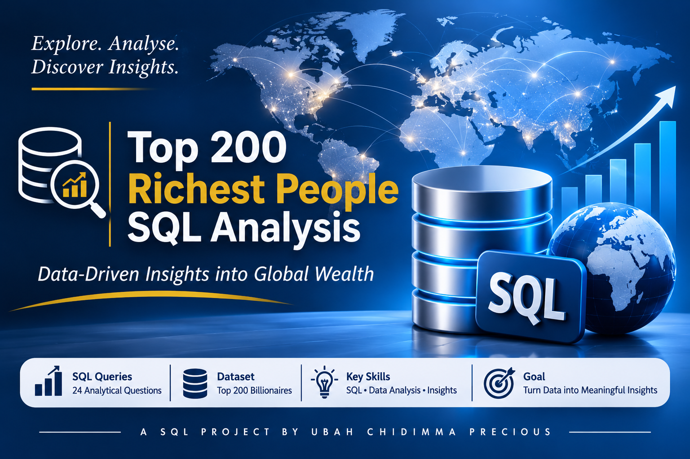

# TOP 200 RICHEST PEOPLE SQL ANALYSIS

## INTRODUCTION

This project uses SQL to explore a dataset containing the 200 richest people in the world. The analysis focuses on billionaire net worth, age, country, industry, and ranking.
The aim is to practise querying, filtering, aggregating, and comparing records using SQLite, and to extract meaningful information from the dataset. 
The objectives of this project are to identify the richest and youngest billionaires in the dataset, examine the distribution of billionaires across countries and industries, calculate total and average net worth for selected groups, compare billionaire wealth across age groups, countries, and industries, practice SQL techniques, including aggregate functions, grouping, filtering, sorting, and subqueries.

## ABOUT THE DATASET
The dataset used for this project is titled Top 200 Richest People in the World.
The analysis contains the following fields: serial number, rank(Ranking in the dataset), name(Billionaire's name), age(Billionaire's age), country(Country associated with the billionaire), net worth billion(Net worth expressed in billions) and industry(Industry associated with the billionaire).

## SQL CONCEPTS DEMONTRATED
The queries in this project practise:
1. SELECT and FROM
2. WHERE and BETWEEN
3. ORDER BY and LIMIT
4. GROUP BY and HAVING
5. Aggregate functions: COUNT(), SUM(), AVG(), MIN(), and MAX()
6. Subqueries, including scalar and correlated subqueries
7. Conditional aggregation using CASE

## ANALYSIS QUESTIONS
The project investigates the following 24 questions:
1. Retrieve the twenty richest billionaires.
2. Identify the five youngest billionaires.
3. Calculate the average age and average net worth.
4. Identify the five most represented countries.
5. Calculate the combined net worth of billionaires from each country.
6. Identify the five industries with the highest number of billionaires.
7. Find countries with at least five billionaires.
8. Calculate the total wealth of billionaires younger than 50.
9. Identify billionaires whose net worth exceeds the overall average net worth.
10. Identify the industry with the highest average net worth.
11. Identify the five youngest billionaires with the highest net worth.
12. Identify the industry with the youngest billionaire.
13. Identify countries with the oldest billionaires.
14. Identify countries with the youngest billionaires.
15. Identify industries that dominate each country.
16. How many billionaires have a net worth above 50 billion dollars?
17. What percentage of the dataset is made up of billionaires younger than 50?
18. Who has a net worth between 50 billion dollars and 100 billion dollars?
19. What is the total wealth of billionaires aged below 50?
20. Which country has the highest number of billionaires below age 40?
21. Which industry contributes the most to the combined wealth of the top 200?
22. What's the difference between the richest and poorest billionaire in the dataset?
23. What's the average net worth of billionaires aged above 70?
24. Which billionaires belong to industries with more than ten representatives?

## KEY FINDINGS
The following findings were calculated directly from the 200-row dataset using the fields
described above. Net worth figures are in US dollars (billions).
1.  **Overall Wealth and Age Profile**:
The 200 billionaires have a combined recorded net worth of $6,368.5 billion ($6.37 trillion).
Average net worth is $31.84 billion, while the median is $22.0 billion.
The average age is 69.38 years. Ages range from 31 to 100, showing that the dataset includes
both younger entrepreneurs and older business leaders.
The richest individual is Bernard Arnault &amp; family, with $233 billion. The lowest recorded net
worth is $10.7 billion, belonging to Suleiman Kerimov &amp; family. The difference between the two
is $222.3 billion.
2.  **The Richest Billionaires**:
The top five by rank are:

| Rank | Number of Billionaires    | Net Worth(US$bn) | Industry |
|------|---------------------------|------------------|----------|
|1|Bernard Arnault & family| 233.0 | Fashion & Retail |
|2| Elon Musk              | 195.0 | Automotive       |
|3| Jeff Bezos             | 194.0 | Technology       |
|4| Mark Zuckerberg        | 177.0 | Technology       |
|5| Larry Ellison          | 141.0 | Technology       |

Technology is strongly represented among the highest-ranked individuals: three of the top five
are associated with the technology industry.

3. **Country Representation and Wealth**:
The United States has the largest representation, with 79 billionaires (39.5% of the dataset).
Their combined net worth is $3,130.9 billion, approximately 49.2% of the total wealth recorded.
China has 17 records after trimming a trailing space from one country label; India has 13, while
Germany and Russia each have 11.
France has the second-highest country-level combined wealth at $478.8 billion, followed by
India at $434.5 billion and China at $387.4 billion (after the same country-label cleanup).
The eight countries represented by at least five billionaires are the United States, China, India,
Germany, Russia, France, Hong Kong, and Australia.

4. **Industry Representation and Wealth**:
Technology is the most represented industry, with 40 billionaires (20% of the dataset).
It also contributes the largest combined wealth: $1,738.8 billion, approximately 27.3% of total
recorded wealth. Fashion & Retail is second by combined wealth at $1,165.5 billion, followed by Finance &
Investments at $852.6 billion. Technology has an average net worth of $43.47 billion per person.
Telecom has the highest calculated industry average at $102 billion, but it contains only one
person in this dataset. This small sample means the figure should not be interpreted as
evidence that telecom billionaires generally have higher wealth.
The six industries with more than ten representatives are Technology (40), Finance &
Investments (32), Fashion & Retail (30), Diversified (15), Food &amp; Beverage (15), and Metals &
Mining (12).

5. **Age and Wealth Patterns**:
16 billionaires (8% of the dataset) are younger than 50. Their combined net worth is $508.3
billion, with an average of approximately $31.77 billion.
Mark Mateschitz is the youngest person in the dataset at 31, with a net worth of $39.6 billion,
associated with Food & Beverage.
Among billionaires younger than 50, Mark Zuckerberg has the highest net worth at $177 billion.
The five highest-net-worth billionaires aged below 50 are Mark Zuckerberg ($177.0bn), Zhang
Yiming ($43.4bn), Mark Mateschitz ($39.6bn), Colin Huang ($38.9bn), and Changpeng Zhao
($33.0bn).
The United States has the highest number of billionaires below age 40, with three. Austria and
the United Arab Emirates have one each.
There are 25 billionaires with net worth above $50 billion.
The average net worth of billionaires older than 70 is approximately $29.75 billion (102 records).

6. **Additional Comparisons**:
The dataset contains 11 billionaires with net worth between $50 billion and $100 billion,
inclusive.
The United States&#39; most common industry is Technology (23 records); France&#39;s is Fashion &amp;
Retail (6); China&#39;s is Technology (6); and Russia&#39;s is Metals &amp; Mining (5).
The average age by country should be interpreted carefully where a country has only one or a
few records. In this dataset, Malaysia has one record aged 100, while Spain has one record
aged 88; these single-record averages do not represent the wider populations of billionaires in
those countries.

**Data quality and interpretation notes**

The source CSV contains inconsistent country labels, including China (a trailing space) and
Brazil (a leading space). Country comparisons above trim leading/trailing spaces before
grouping; this changes China from 16 to 17 records and Brazil from 3 to 4. Other figures are
calculated from the original 200 rows.
The dataset has 200 rows and the analysis found no fully duplicated rows or missing values in
the fields used.
The dataset is a snapshot, not a live ranking. Net worth and rankings can change over time.
Industry and country are treated as supplied classifications. The analysis does not
independently verify how each billionaire&#39;s country or industry was assigned.
“Between $50 billion and $100 billion” is treated as inclusive of both endpoints. “Above $50
billion” is strictly greater than $50 billion. “Younger than 50” and “older than 70” are also strict
comparisons.
The analysis describes patterns in this particular top-200 list; it does not establish that country,
age, or industry causes a person to have a particular level of wealth.

## CONCLUSION
This project provided an opportunity to apply SQL to a real-world-style dataset and explore patterns in billionaire wealth, age, countries, and industries. It demonstrates the use of SQL for data retrieval, aggregation, filtering, sorting, and subquery-based analysis.

